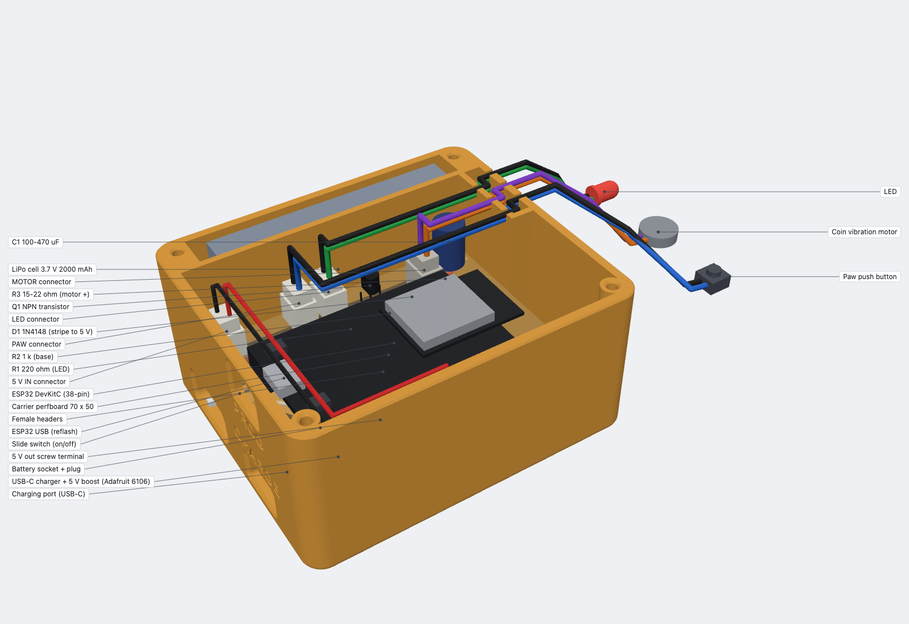
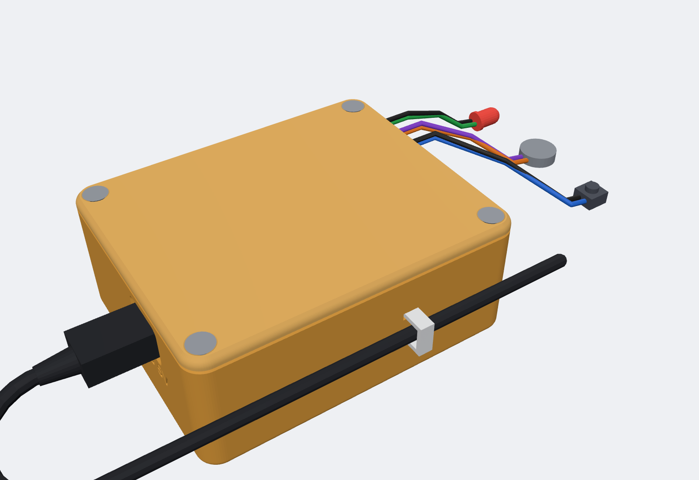
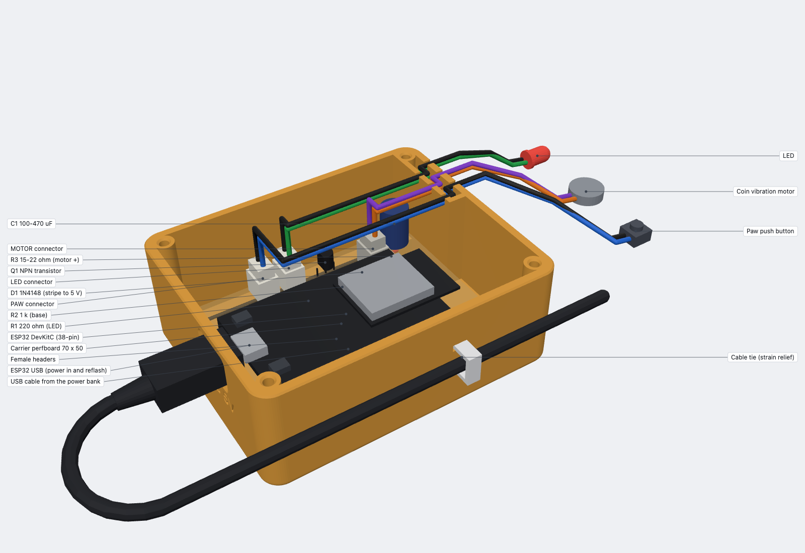
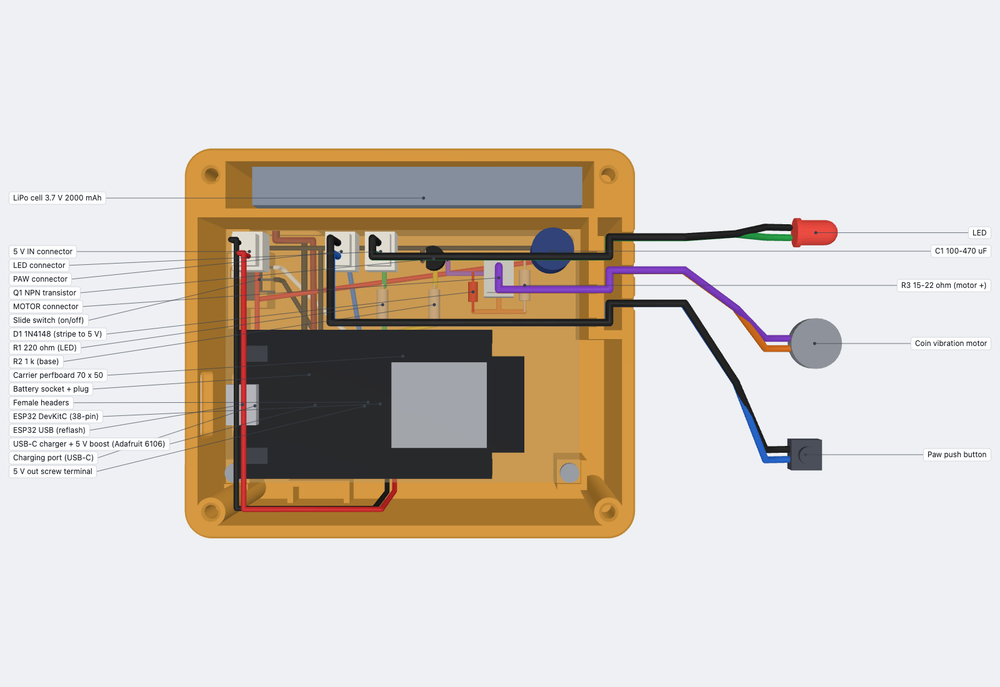
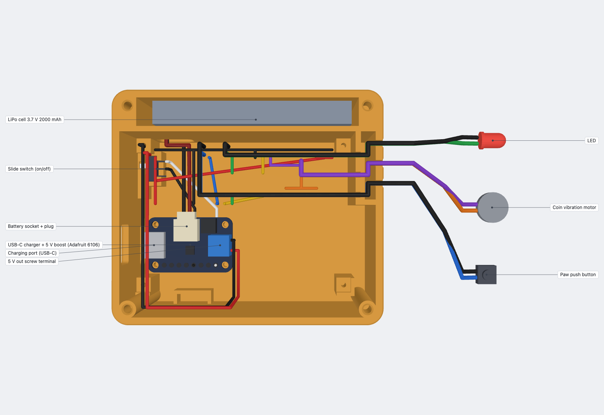

# Teddy electronics box

A 3D-printable box for the bear's electronics: the carrier perfboard with the
ESP32, the USB-C charger board (Adafruit bq25185 charger + 5 V boost, product
6106), a LiPo cell in its own compartment, an on/off switch, and exits for the
motor, LED and paw-button leads.



Nothing here has been printed yet, and most part sizes are typical values, not
caliper measurements. Read "Measure before printing" first.

There is also a smaller **USB-powered version** with no battery, charger or
switch, for a prototype that runs from a power bank. See "USB-powered version"
below.

## What is in this folder

| File | What it is |
|---|---|
| `enclosure.scad` | The parametric model: box body and lid. All dimensions are in one block at the top |
| `assembly.scad` | Every part placed in the box with colour-coded wires (open in OpenSCAD, F5) |
| `stl/38pin/`, `stl/30pin/` | Ready-to-print `teddy-box-body.stl` and `teddy-box-lid.stl` for each board |
| `stl/usb-38pin/`, `stl/usb-30pin/` | The same two parts for the USB-powered version |
| `assembly-usb-38pin.html`, `assembly-usb-30pin.html`, `.glb` | The USB-powered version as a 3D page and model |
| `assembly-38pin.html`, `assembly-30pin.html` | The wired assembly as a 3D page: double-click, then drag to rotate. No CAD software or internet needed |
| `assembly-38pin.glb`, `assembly-30pin.glb` | The same assembly for any 3D viewer |
| `renders/` | PNG views |
| `build.sh`, `tools/` | Regenerates all of the above and runs the checks |

The box is 81.4 x 70.6 x 42.5 mm outside for the 38-pin board (Ellie) and
83.7 x 70.6 x 42.5 mm for the 30-pin board (Bruno). The 30-pin box is 2.3 mm
longer because that board overhangs the end of the perfboard (see below).

## USB-powered version




Set `power = "usb"` in `enclosure.scad`, or use the files in `stl/usb-38pin/`
and `stl/usb-30pin/`. A power bank plugs into the ESP32's own USB socket, so
the battery slot, the charger mounts, the switch and the second USB opening
are all gone.

| | Battery version | USB-powered version |
|---|---|---|
| 38-pin board (Ellie) | 81.4 x 70.6 x 42.5 mm | 80.5 x 65.5 x 33.0 mm |
| 30-pin board (Bruno) | 83.7 x 70.6 x 42.5 mm | 83.7 x 65.5 x 33.0 mm |

What is different:

- **One opening**, marked USB 5V, for the plug in the ESP32. It is sized for
  the largest plug body the USB standard allows.
- **Carrier 5 mm above the floor** instead of 15 mm, because nothing sits under
  it. That is 3 mm for its solder joints and links, plus 2 mm of air.
- **Cable tie slots.** Two slots through the long wall beside the ESP32. Loop
  the power cable back from the plug, lay it along that wall and tie it down
  through the slots with a 3.6 mm cable tie. A tug on the cable then pulls on
  the box, not on the ESP32's socket. Thread the tie before the carrier goes
  in: in through one slot, out through the other.
- **Three carrier screws** instead of two. With no 5 V IN connector fitted, the
  far corner at the USB end is free for an M2 x 5 screw.
- **Four lid screws** as before. The strip that held the battery shrinks to a
  5 mm strip that only holds the two far lid screw posts.

The length is set by the 70 mm carrier plus the lead strain relief, and the
width by the 50 mm carrier plus a strip each side for the lid screws. Going
smaller than this needs a smaller carrier board.

The same checks pass for this version (see "Checks that were run"), with the
cable and tie in place of the charger, battery and switch: the tie clears its
slots by 0.35 mm and a full-size plug clears the opening by 0.39 mm.

## Layout



- **Port wall** (left in the picture): ESP32 USB for reflashing at the top
  (marked PROG), the charger's USB-C socket below it (marked CHARGE), slide
  switch in a finger recess beside it. The lever ends 0.2 mm below the wall surface, so
  nothing sticks out into the stuffing.
- **Carrier** sits on four 15 mm posts. The **charger board and the switch
  are underneath it**. The charger is on four screw standoffs with its USB-C
  socket 0.2 mm behind the wall. Its 5 V screw terminal, the tallest part,
  sits under the ESP32 between the two header rows, where the carrier has no
  solder joints; 1.9 mm of air is left above a 9 mm terminal.
- **Battery** stands on its long edge in a walled slot on the far side from the
  ESP32. Its lead reaches the charger through a rounded window. The lid
  screws go into blind holes in solid corner blocks, so no screw tip can reach
  the cell, and the motor pocket is on the opposite wall.
- **Lead exits** are on the wall the antenna end faces, off to the battery side
  so the wall directly in front of the antenna stays plain. Each lead drops
  into a slot in an inner fence, steps sideways 3.5 mm, and leaves through a
  slot in the wall; the lid pinches it. That S-bend is the strain relief.
- **Coin motor pocket** is against the long wall beside the ESP32, for
  `motor_in_box = true`.
- **Lid**: four M3 x 10 countersunk screws driven straight into 2.5 mm pilot
  holes (thread-forming, no inserts). Set `lid_insert = true` for M3 heat-set
  inserts. Four fins under the lid hold the carrier down on its posts.



More views: [lead exits](renders/assembly-lead-exits.png),
[battery side](renders/assembly-battery-side.png),
[links under the carrier](renders/assembly-underside.png),
[closed box, port side](renders/closed-port-side.png),
[30-pin board](renders/assembly-30pin-top.png).

## Regenerate

```sh
./build.sh
```

That needs only OpenSCAD (`brew install --cask openscad@snapshot`) and rewrites
the four STLs. To pass overrides without editing the file:

```sh
SCAD_ARGS="-D motor_in_box=true -D wire_d=1.2" ./build.sh
```

To rebuild the viewer, the PNGs and rerun the checks as well:

```sh
python3 -m venv .venv && .venv/bin/pip install -r tools/requirements.txt
```

```sh
./build.sh all
```

The PNG renders use Google Chrome in headless mode. Check reports land in
`build/` (not committed).

## Measure before printing

Everything is in the parameter block at the top of `enclosure.scad`. These are
the ones that depend on a part you have in your hand:

Check these first. They are the charger board's heights, which are not in
Adafruit's board file, so they are estimates:

| Parameter | Default | Measure |
|---|---|---|
| `chg_top_h` | 9.0 | Height of the 5 V screw terminal above the charger board. Generic 3.5 mm blocks run 8.5 to 10 mm. Anything up to 10 mm fits as is; taller needs `perf_standoff_h` raised |
| `chg_usb_h` | 1.65 | USB-C socket centre above the charger board (half of the 3.26 mm shell in the socket maker's datasheet) |
| `chg[2]` | 1.6 | Charger board thickness |

The charger's outline, four mounting holes, socket and pad positions come from
Adafruit's board file (`chg`, `chg_holes`, `chg_usb_cy`, `chg_usb_overhang`,
`chg_jst`, `chg_term`, `chg_pad_x`). One check with calipers is enough: the
board should be 29.2 x 19.05 mm with holes 24.13 x 13.97 mm apart.

The rest depend on parts you have in your hand:

| Parameter | Default | Measure |
|---|---|---|
| `board` | `"38pin"` | `"38pin"` or `"30pin"`: picks the ESP32 row below |
| `perf` | 70 x 50 x 1.6 | Perfboard length, width, thickness |
| `perf_grid_x0`, `perf_grid_y0` | 5.79, 3.41 | Centre of the first hole from the short edge and from the long edge |
| `perf_hole_inset` | 2.0 | Corner mounting holes: centre to each edge. Set to match, or ignore the screws and rely on the lid fins |
| `esp_38`, `esp_30` | see file | Overall length, PCB length, width, row-to-row spacing, pins per side, **USB-end pin to the USB end of the board** |
| `esp_usb_type` | `"micro"` | `"micro"` or `"c"`: the socket on your ESP32 dev board |
| `esp_usb_overhang` | 1.0 | How far that socket sticks out past the board end |
| `header_h`, `pin_spacer_h`, `esp_pcb_t` | 8.5, 2.5, 1.6 | Female header height, the plastic strip on the ESP32's pins, board thickness. Together they set the height of the PROG cut-out |
| `esp_usb_h_micro` / `_c` | 1.3 / 1.7 | Socket centre above the ESP32 board |
| `batt` | 60 x 36 x 7 | Battery length, width, thickness. The box grows with it |
| `sw_body`, `sw_lever_len`, `sw_lever_w`, `sw_travel` | 8.5 x 3.5 x 3.5, 4, 1.5, 2 | Slide switch body, lever length, lever width, travel |
| `n_leads`, `wire_d` | 3, 1.4 | Leads leaving the box, and the outside diameter of **one** wire. The exit slot is one wire wide and two wires deep |
| `motor_in_box`, `motor_d`, `motor_t` | false, 10, 3 | Motor in the pocket (two exits) or on a lead (three exits) |
| `wall`, `floor_t`, `lid_t`, `tol` | 2.4, 2.0, 3.0, 0.3 | Shell thickness and the clearance left around every part |
| `lid_insert`, `lid_pilot_d`, `lid_head_d` | false, 2.5, 6.0 | Lid screw type and sizes |

Quick dry fit before committing to a 5-hour print: print the first 12 mm of the
body (cut it in the slicer). That gives the charging cut-out, the switch pocket,
the charger standoffs and the battery slot width.

## Print settings

- **Material**: PETG. The charger and cell get warm inside stuffing, and PLA
  softens from about 55 °C.
- **Layer height** 0.2 mm, 0.4 mm nozzle, 3 walls, 4 top and bottom layers,
  20 % infill.
- **Orientation**: as exported. Body with its open side up, lid with its outer
  face on the bed and the fins pointing up.
- **Supports**: none. The only overhangs are bridges: the two USB cut-outs
  (12.4 and 13.6 mm), the switch recess (18 mm) and the battery lead window
  (12 mm).
  The edges that touch the bed are a 45° chamfer blending into a round, so
  they print cleanly.
- About 61 g (body) and 24 g (lid) if printed solid; less with infill.

## Hardware

- 4 x M3 x 10 countersunk screws (lid). No longer than 12 mm.
- 6 x M2 x 5 pan-head self-tapping screws (4 charger board, 2 carrier). Not
  longer: the charger's holes stop 0.7 mm above the outside of the floor.
- A strip of thin foam for the battery slot, and hot glue for the switch.

## Assembly order

1. **Dry fit**: carrier in its bay, charger board on its standoffs, battery in
   its slot, a USB plug through each cut-out.
2. **Switch**: solder two wires (about 7 cm) to the centre pin and one outer
   pin. Slide the lever to one end, lower the switch into its pocket with the
   lever poking out through the slot, lever towards the battery side on the way
   down. Fix it with hot glue over the top, which also closes the slot.
3. **Charger board**: solder the two switch wires to the **EN** and **G**
   pads. Clamp a 14 cm red/black pair in the screw terminal (**+** red, **–**
   black; the wires enter from the end away from the USB-C socket) and put a
   JST-XH plug on its other end. Do this now: the terminal's screws are under
   the carrier once the box is built.
4. **Motor**, if it lives in the box: stick it in the pocket on the gutter wall.
5. **Battery**: thread its plug through the window into the main bay, plug it
   into the charger (switch off: EN joined to G), lower the charger onto its
   four standoffs and fit four M2 screws. Lower the cell into its slot with the
   foam strip.
6. **Carrier**, without the ESP32: run the 5 V pair up the gutter, lower the
   board onto its posts, fit the two M2 screws on the gutter-side corners.
7. Plug in the ESP32 (USB towards the port wall), then the four connectors.
8. **Leads**: lay each one into its fence slot and then its wall slot, one wire
   on top of the other. A small cable tie on the lead just inside the fence is
   a good extra stop.
9. **Lid**: check no wire lies on the wall tops, then four M3 screws, snug only.

To get at the battery plug or the screw terminal later, undo the two carrier
screws and lift the carrier.

## Checks that were run

From `./build.sh all`, for both boards, with the motor on a lead and in the box:

- **Printable STLs** (`tools/check_mesh.py`): all four pass. Watertight,
  consistent winding, 0 open edges, 0 non-manifold edges, one body each, and
  the manifold kernel reports no error.
- **Fit** (`tools/build_assembly.py`): exact boolean intersections between
  every solid part and the body, the lid and every other part: 0 mm³ in all
  four configurations. Wires touch only the parts they join.
- **Under the carrier**: a 3 mm deep block standing for the carrier's solder
  joints and links (under hole columns 1 to 8 and 17 to 18) is intersected
  with every part: nothing intrudes. The charger's screw terminal is 1.9 mm
  from the bare underside of the carrier.
- **Openings**: a plug body of the USB spec's maximum size pushed fully home
  in each socket (USB-C 12.35 x 6.5 mm in the charger, micro-USB 10.6 x 8.5 mm
  in the ESP32) clears the box by 0.25 mm or more and is centred on the socket
  to 0.00 mm. The switch lever clears its slot by 0.35 mm in both positions
  and its tip is 0.2 mm inside the wall face.
- **Clearances** to the printed box are listed per part in
  `build/assembly-*-check.txt`. The tightest are the lid fins beside the
  ESP32 (0.56 mm on the 30-pin board, 0.74 mm on the 38-pin).
- The renders in `renders/` were looked at by eye.

## Assumptions about part sizes

Verified from Adafruit's published Eagle board file for product 6106
(`adafruit/Adafruit-bq25185-with-5V-Boost-PCB`, board rev B):

- Charger board outline 29.21 x 19.05 mm with 2.54 mm corner radii.
- Four 2.5 mm mounting holes, 2.54 mm in from each edge (24.13 x 13.97 apart).
- USB-C socket centred on one short edge, mouth 1.14 mm past the edge.
- JST-PH battery socket opening on a long edge; the plug goes in across the
  board.
- 5 V screw terminal (3.5 mm pitch, 7 x 7 mm body) at the other short edge,
  wires entering from that end, **+** nearer the pad row.
- Pad row along the other long edge: VIN, VU, D–, D+, G, BAT, 5V, EN.

From the socket makers' datasheets: USB-C shell 8.94 wide, 3.26 high; JST
socket 5.5 high.

Verified from Espressif's drawing: 38-pin DevKitC V4 PCB 48.26 x 27.94 mm,
54.3 mm overall with the antenna, rows 25.4 mm apart, end pins 1.27 mm from the
board ends. Many clones are narrower (22.86 mm rows): if yours is, change
`esp_38` and the header column in the carrier drawing.

Typical values, **not verified**:

- Charger board thickness 1.6 mm. Screw terminal 9 mm high: the board file
  names no part, and generic blocks run 8.5 to 10 mm.
- 30-pin DevKit V1: 51.5 x 28.3 mm, rows 25.4 mm apart, USB-end pin 8.0 mm
  from the board end. No maker's drawing was found; the 8.0 is a guess from a
  symmetric layout and it sets how far the board overhangs the perfboard.
- Perfboard: 70 x 50 x 1.6 mm, 24 x 18 holes, first hole 5.79 mm and 3.41 mm
  from the edges, 2 mm corner holes 2 mm from each edge.
- Female headers 8.5 mm tall, 2.5 mm pin spacer, ESP32 USB socket overhanging
  its board by 1.0 mm, tallest ESP32 part 3.4 mm.
- Battery 60 x 36 x 7 mm (Adafruit's listed size for the 2000 mAh cell, no
  tolerance given). The slot allows 2 mm in length, 1.5 mm in thickness and
  height, plus 4.5 mm for the lead.
- Slide switch SS12D00: body 8.5 x 3.5 x 3.5 mm, lever 1.5 mm square and 4 mm
  long, 2 mm travel (from one maker's drawing; clones run up to 8.8 x 3.9).
- Coin motor 10 x 3 mm. Lead wire 1.4 mm outside diameter.
- Micro-USB plug body no larger than 10.6 x 8.5 mm, USB-C 12.35 x 6.5 mm (spec
  maximums quoted from memory, not re-read).
- JST-XH connectors on the carrier 7.4 x 5.75 x 7 mm, 10.5 mm tall with the
  plug in. Capacitor up to 8 x 12 mm.

## Things to know

- **The ESP32 does not sit flush with the perfboard edge.** The carrier
  drawings put its USB-end pin in the last hole row, which is 5.8 mm in from
  the edge. So the 38-pin board's USB socket ends up 3.8 mm behind the wall.
  The PROG cut-out is sized for the plug's moulded body, which passes through
  the wall and reaches it. The 30-pin board is the other way round: with the
  guessed 8.0 mm it overhangs the perfboard by 2.2 mm, and its box is made
  longer to suit.
- **Two carrier corner holes are covered.** In `carrier-38pin.svg` and
  `carrier-30pin.svg`, C1 (if 8 mm across) and the 5 V IN connector sit over
  the two battery-side corner holes, so a screw head will not fit there. The
  box has pilot holes in all four posts, but only the two gutter-side screws
  are used; the lid fins hold the other edge. Moving C1 and 5 V IN one hole
  inboard would free all four.
- **The battery plug and the 5 V screw terminal are under the carrier.** That
  is the price of the small footprint. The switch turns the 5 V output off;
  unplugging the cell or re-clamping a wire means lifting the carrier (two
  screws).
- **Charging makes heat.** The board charges at up to 1 A inside a closed box
  inside stuffing. Charge the bear in the open, not under a duvet.
- **The charger's lights are inside the box.** The orange charging light and
  the red fault light cannot be seen with the lid on.
- **PowerBoost 1000C.** The first version of this box (commit `be76edd`) was
  built around the PowerBoost, the fallback charger named in the main README.
  This version does not fit it: that board is 7 mm longer and has only two
  mounting holes.
- The wire colours match the carrier drawings: red 5 V, black GND, green
  GPIO 25 (LED), yellow GPIO 26 (to the transistor), blue GPIO 27 (paw),
  orange motor +, purple motor -. White is the switch's EN wire.

## Not verified

- No test print. Fit of the switch pocket, the lid screws in their pilot
  holes, the lead pinch and the bridges is untested.
- Not sliced: "no supports" comes from the geometry, not from a slicer preview.
- The viewer was checked in Chrome only.
- Every size under "Typical values" above.
