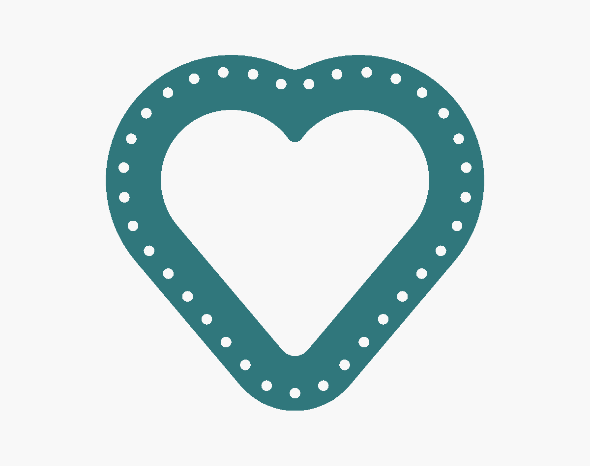
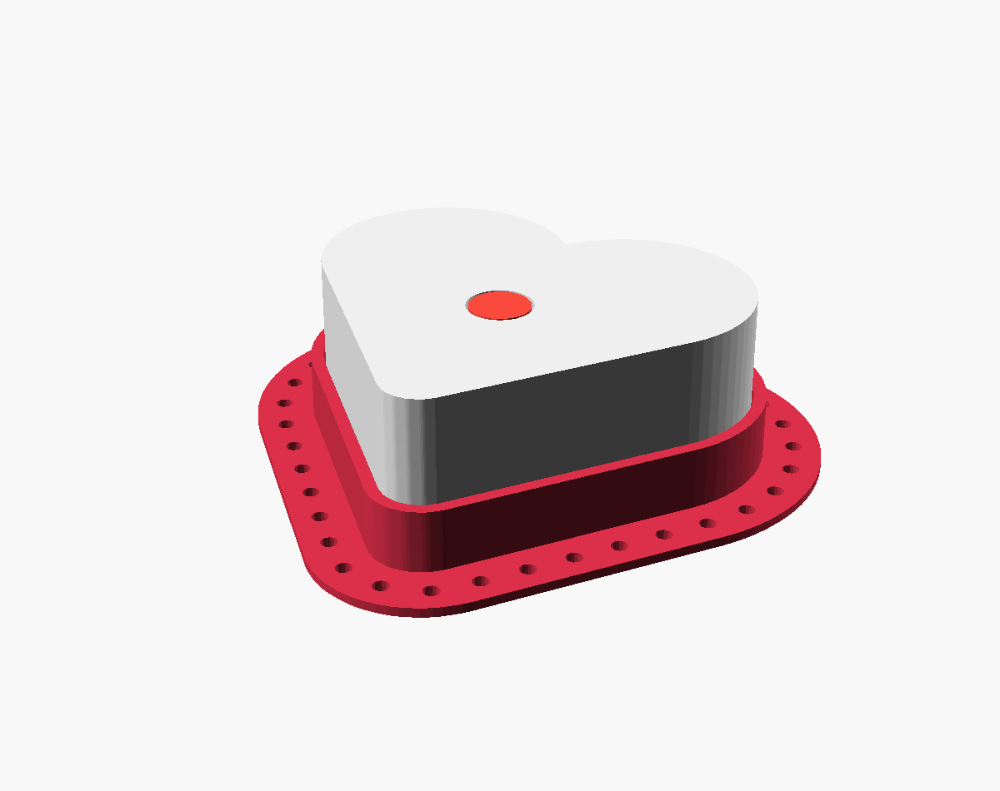

# Stitch-on heart for the LED

A heart-shaped window for the front of the bear. You cut a heart-shaped hole in
the fabric, push this through from the outside and sew it on through the holes
in its rim. The LED sits in a cup behind it.

Nothing here has been printed yet.

## Parts

| File | Print in | What it is |
|---|---|---|
| `heart-frame-outline.stl` | any colour | Frame with an open window. Glue diffuser film to the ledge behind the window |
| `heart-frame-full.stl` | transparent PLA | The same frame with the window closed by a 0.8 mm lens. No film needed |
| `heart-cup.stl` | white | Light box that pushes into the back of the frame and holds a 5 mm LED |

Three sizes are built, in `stl/30mm`, `stl/40mm` and `stl/50mm`. The number is
the width of the lit window:

| Window | Whole frame | Hole to cut in the fabric | Depth behind the fabric |
|---|---|---|---|
| 30 mm | 46 x 44 mm | 35 x 33 mm | 16 mm |
| 40 mm | 56 x 53 mm | 45 x 42 mm | 16 mm |
| 50 mm | 66 x 62 mm | 55 x 51 mm | 16 mm |

For another size: `SIZES="36" ./build.sh`, or change `heart_w` at the top of
`heart.scad`.

## How it goes together

1. **Frame.** A flat plate 1.2 mm thick lies on the outside of the fabric and
   hides the cut edge. It has stitch holes 1.6 mm across, about 4.5 mm apart,
   all the way round. A wall 6 mm tall behind it goes through the hole.
2. **Film** (outline frame only). Cut the film to the inside of that wall and
   glue it to the 1.5 mm ledge behind the window. Baking paper or a piece of a
   white carrier bag both work as a diffuser.
3. **Cup.** Push it into the back of the frame until its rim sits on the ledge.
   It is a sliding fit with 0.2 mm of clearance, so add a few drops of glue.
4. **LED.** Push the LED into the hole in the back of the cup from outside. Its
   flange sits in a recess. Fix it with hot glue, which also insulates the legs.

To trace the hole on the fabric, draw round the wall on the back of the frame.

## Printing

- Frame: front face down, no supports. The face on the bed is the face you see.
- Cup: back face down, no supports. White reflects the most light.
- 0.2 mm layers, 0.4 mm nozzle. The walls are 1.2 mm, which is three passes.
- The full frame's lens is four layers. Use 100% infill so the lens is solid.

## Things to know

- **Hot spot.** The LED tip ends up about 7 mm behind the window, so the centre
  will be brighter than the lobes. A diffused LED, a second layer of film, or a
  larger `cup_depth` all even it out.
- **Sizes of small parts** are typical values, not measurements: a 5 mm LED
  with a 5.8 mm flange. `led_d` and `led_flange_d` are at the top of the file.
- **Small parts and children.** A sewn-on rigid part can be pulled off. This is
  a prototype, not a toy for small children.

## Checks that were run

`./build.sh all` runs them and writes the results to `build/`.

- Every STL is a closed, single-piece solid that sits flat on the bed.
- For each size and both frame styles, the cup pushed home does not intersect
  the frame. The gap is 0.2 mm at the wall and 0.1 mm at the rim, where the
  film goes.
