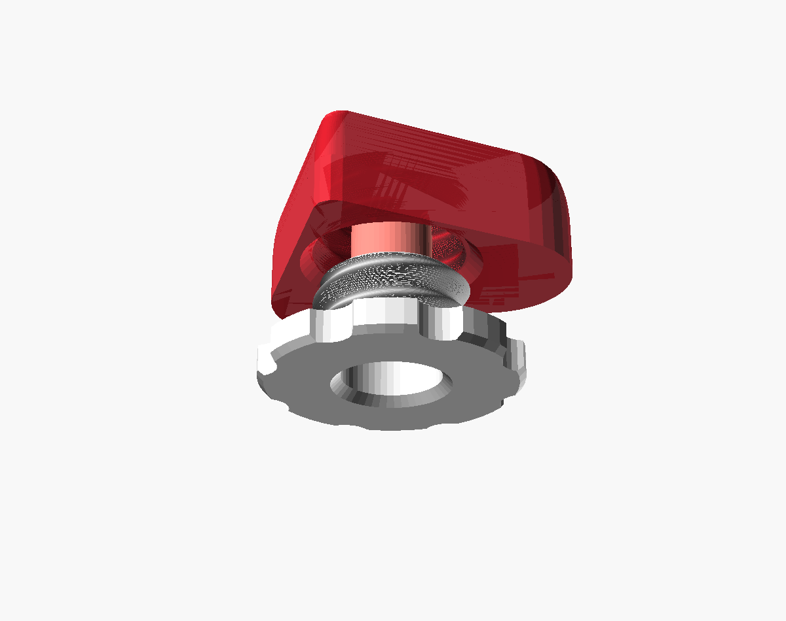

# Light-up heart that fits like a safety eye

A heart for the front of the bear that needs no sewing. It is two printed
parts that screw together through a hole in the fabric, and the LED sits
inside, hidden from the front.

Nothing here has been printed yet.

## Parts

| File | What it is | Filament |
|---|---|---|
| `stl/heart-20mm.stl`, `heart-25mm.stl`, `heart-30mm.stl` | The heart: solid, with a threaded hole in its flat back. It sits on the outside of the fabric | Translucent red |
| `stl/heart-bolt.stl` | A hollow bolt with a wide head. It goes through the fabric from inside the bear and screws into the heart. One bolt fits every size | Any |

The LED pushes in through the hollow bolt until its tip stops 1.4 mm behind
the front of the heart.

| Heart | Size | Height | Thinnest wall beside the thread |
|---|---|---|---|
| 20 mm | 20 x 18 mm | 6.6 mm | 1.1 mm |
| 25 mm | 25 x 23 mm | 6.6 mm | 2.6 mm |
| 30 mm | 30 x 28 mm | 6.6 mm | 4.3 mm |

The bolt's head is 16 mm across and 2 mm thick, and its thread is 9.6 mm
across. So behind the fabric the whole thing is 16 mm across, and the LED's
legs come out of the middle.

Another size: `SIZES="22" ./build.sh`. Everything else is at the top of
`heart.scad`.

## Fitting it

1. Make a hole about 10 mm across in the fabric where the heart will go. A
   small cross cut also works.
2. Hold the heart on the outside. From inside the bear, push the bolt through
   the hole and screw it into the heart until the fabric is pinched firmly
   between them. The notches round the bolt's head are for your fingers.
3. Push the LED into the bolt, tip first, until it stops. Its back end stands
   about 1.5 mm out of the bolt when there is no fabric, less with fabric.
4. Fix the LED with hot glue in the back of the bolt. That also insulates the
   legs.
5. For a permanent fit, put a drop of glue on the thread before step 2.

Fabric up to 2.5 mm thick, squashed, leaves at least 2.5 mm of thread
engaged. Pile compresses, so most plush is fine.

## Printing

- **Heart**: flat on its back, no supports, translucent red PLA or PETG.
  Print it solid (100% infill, or enough walls to fill it) so it glows evenly.
  0.2 mm layers, or 0.1 mm for a smoother top.
- **Bolt**: head down, thread up, no supports. Three or more walls.
- The flat end of the threaded hole is printed as a bridge about 10 mm
  across. It may sag a little. That is inside the heart and only matters if it
  stops the bolt going fully in.

## Things to know

- **The 20 mm heart is a flat-topped pillow, not a dome.** The thread has to
  be 9.6 mm across to let the LED's 5.8 mm flange through, and that is half
  the width of a 20 mm heart. Its sides have to stay steep to leave plastic
  round the hole, so only its top edge is rounded. The 25 and 30 mm hearts are
  properly domed. All three are the same height.
- **The 20 mm heart has only 1.1 mm of plastic beside the thread** at three
  points. Do not over-tighten it.
- **The thread fit depends on your printer.** There is 0.35 mm of air each
  side. Too tight: `SCAD_ARGS="-D th_clear=0.45" ./build.sh`. Too loose: 0.25.
  Changing it rebuilds the hearts only, since the bolt stays the same.
- **Brightness.** With the tip right behind the front you get a bright spot in
  the middle and a softer glow round it. For a more even glow, pull the LED
  back 2 or 3 mm before gluing it.
- **LED size** is a typical value, not a measurement: 5 mm body, 5.8 mm
  flange, 8.6 mm long. If the flange does not pass, raise `bore_d`.
- **Small parts and children.** Either part can be unscrewed by hand unless
  the thread is glued. This is a prototype, not a toy for small children.

## Checks that were run

`./build.sh all` runs them and writes the results to `build/`.

- Every STL is a closed, single-piece solid that sits flat on the bed.
- For each size, the bolt was placed in the heart with 0, 1 and 2.5 mm of
  fabric between them. It never cuts into the heart, and the threads keep
  0.19 mm apart at their closest.
- The LED, pushed fully in, cuts into neither part and has 1.4 mm of plastic
  in front of its tip.

How the thread feels, and how well the heart glows, are not checked: the first
print will show both.

The earlier versions of this part are in the git history: a stitch-on domed
heart with the LED poking out (commit `d48f284`), and before that a frame with
a film window (commit `c7d99c9`).
