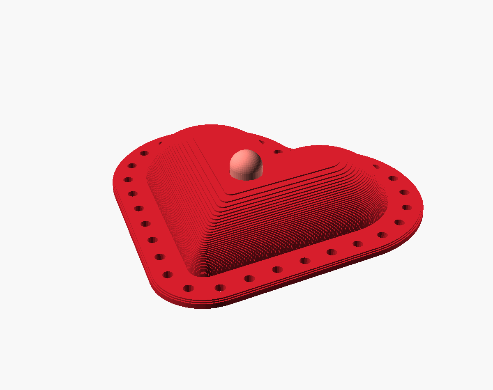
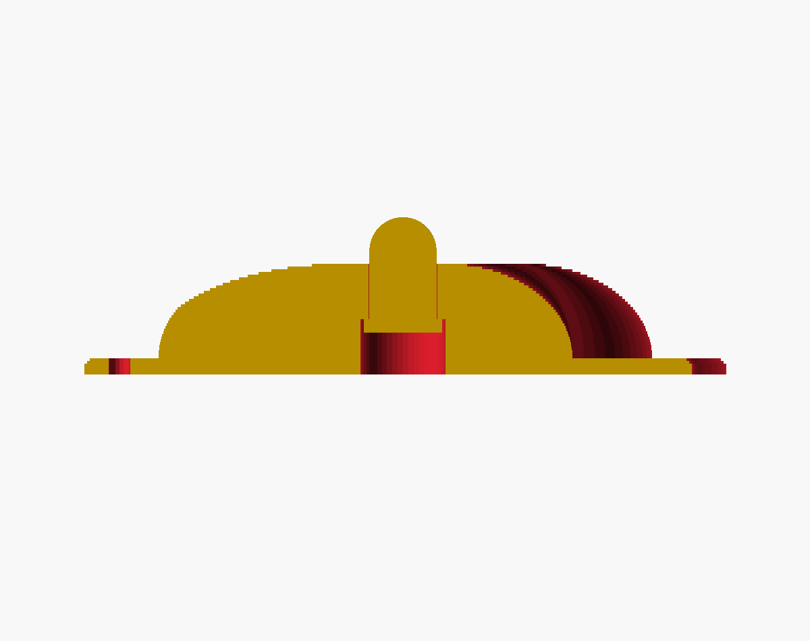

# Stitch-on heart for the LED

A domed heart for the front of the bear, printed in one piece in red. It has a
flat rim of stitch holes round it, and the 5 mm LED pokes out through the
middle of the dome.

Nothing here has been printed yet.

## Sizes

One file per size, in `stl/`. The number is the width of the dome:

| File | Dome | With the rim | Height | Stitch holes |
|---|---|---|---|---|
| `heart-30mm.stl` | 30 x 28 mm | 41 x 39 mm | 8.2 mm | 24 |
| `heart-40mm.stl` | 40 x 37 mm | 51 x 48 mm | 8.2 mm | 31 |
| `heart-50mm.stl` | 50 x 46 mm | 61 x 57 mm | 8.2 mm | 38 |

The LED tip stands 3.5 mm above the dome on all three.

Another size: `SIZES="36" ./build.sh`. A taller dome:
`SCAD_ARGS="-D dome_h=9" ./build.sh`. Everything else is at the top of
`heart.scad`.

## Fitting it

1. Push the LED in from the back until its flange stops in the recess. The
   recess is 4 mm deep, so the bent legs and solder joints sit inside it.
2. Fix it with hot glue from the back. That also insulates the legs.
3. Make a small hole in the fabric where the middle of the heart will go and
   pass the two wires through. There is no heart-shaped hole to cut.
4. Sew the heart onto the outside of the fabric through the holes in the rim.
   The holes are 1.6 mm across and about 4.5 mm apart.

## Printing

- Flat on its back, no supports. Red PLA or PETG.
- 0.2 mm layers, or 0.1 mm for a smoother dome. The dome is built in 0.2 mm
  steps, so the gentle slope near the top shows fine contour lines at any
  layer height. A light sanding takes them off.
- Three or more walls and 20% infill is plenty.

## Things to know

- **Only the LED tip lights up.** The heart is solid red, so it does not glow.
  A wide-angle or diffused LED is easier to see from the side.
- **LED size** is a typical value, not a measurement: 5 mm body, 5.8 mm
  flange, 8.6 mm long. If yours is loose or tight, change `led_d` at the top of
  `heart.scad`.
- **Small parts and children.** A sewn-on rigid part can be pulled off. This is
  a prototype, not a toy for small children.

## Checks that were run

`./build.sh all` runs them and writes the results to `build/`.

- Every STL is a closed, single-piece solid that sits flat on the bed.
- For each size, a 5 mm LED pushed fully in does not cut into the heart, its
  tip stands 3.5 mm proud of the dome and its flange sits 3.1 mm inside the
  back face.

The first version of this part, a frame with a film window and a separate LED
cup, is in the git history (commit `c7d99c9`).
