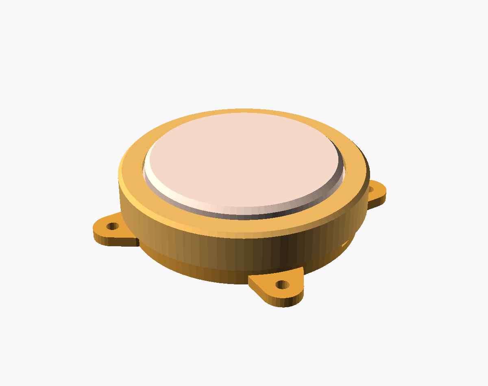
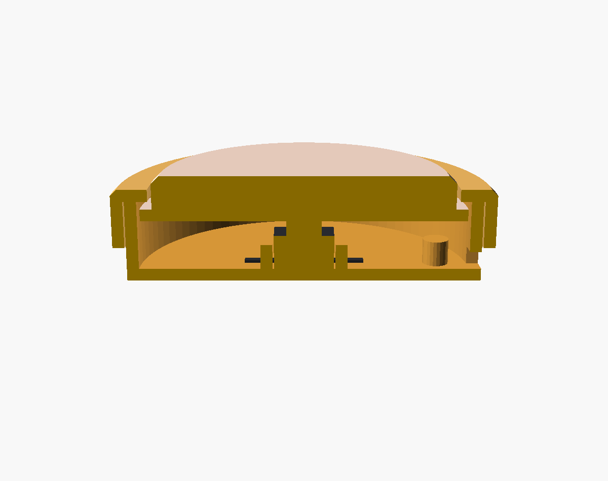
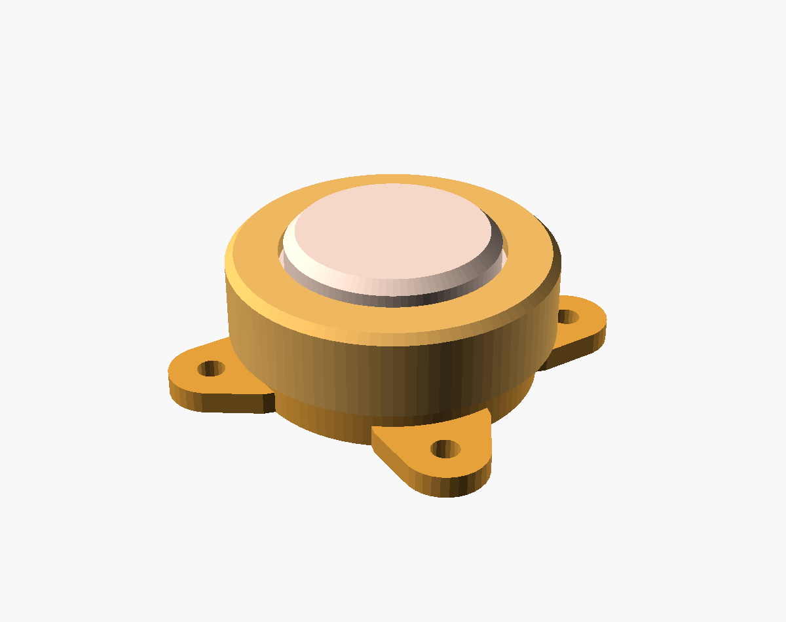
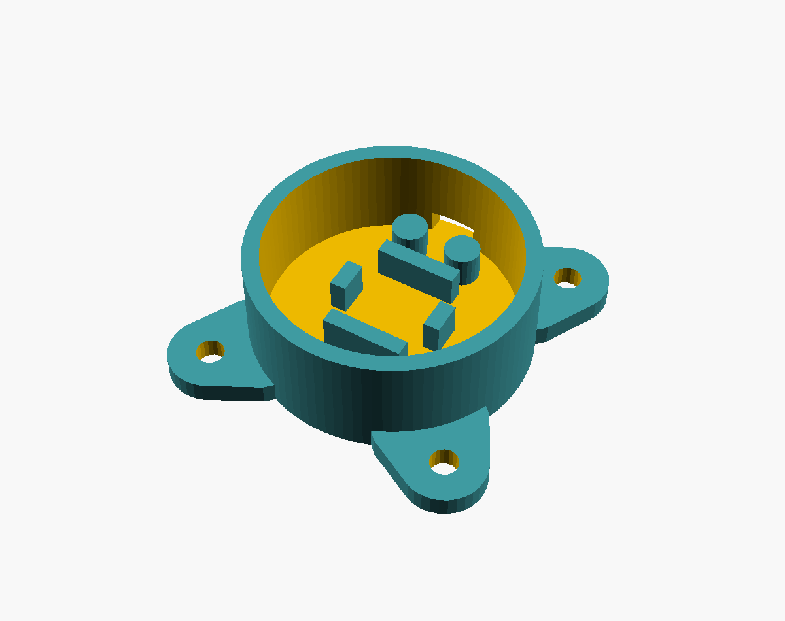

# Squeeze pad for the paw button

A small round pod that turns the 6 x 6 mm tactile switch into a button you can
find through stuffing. Press the plate anywhere and the switch clicks. It wires
to the same two pins as the bare switch, so the firmware does not change.

Nothing here has been printed yet.

## Parts

| File | What it is |
|---|---|
| `paw-pad-base.stl` | Dish that holds the switch and the two wires. Four tabs with holes to sew it in place |
| `paw-pad-plate.stl` | Loose disc that rests on the switch plunger. This is what you press |
| `paw-pad-ring.stl` | Slips over the base and keeps the plate in |

Four sizes are built, in `stl/15mm`, `stl/25mm`, `stl/30mm` and `stl/40mm`.
The number is the diameter of the plate:

| Plate | Pod across | Across the sewing tabs | Height |
|---|---|---|---|
| 15 mm | 23.1 mm | 32.1 mm | 10.8 mm |
| 25 mm | 33.1 mm | 42.1 mm | 10.8 mm |
| 30 mm | 38.1 mm | 47.1 mm | 10.8 mm |
| 40 mm | 48.1 mm | 57.1 mm | 10.8 mm |

Another size: `SIZES="35" ./build.sh`. No tabs: `SCAD_ARGS="-D tabs=0" ./build.sh`.

The 15 mm pad is close to the smallest this design goes: the switch with its
legs bent out flat is 12 mm across, and the wall and ring add 4 mm a side
round the plate. Its base is laid out differently. The wire slot and the two
posts are a quarter turn round, on a side of the switch that has no legs,
because on a pod this small they would otherwise land on the legs. Plates
under 19 mm get this layout automatically.

## How it works

The plate is not fixed to anything. It rests on the plunger and has 0.8 mm of
free play under the ring.

- **Press in the middle** and it pushes the plunger straight down.
- **Press near an edge** and it tips. The far edge catches under the ring, and
  the plate becomes a lever that pushes the plunger with about twice the force
  of your finger.

## Measure your switch first

The pod is built for a switch that is **5.0 mm tall**, from the underside of
its body to the top of its plunger. Common 6 mm switches come in 4.3, 5, 7 and
9.5 mm.

- A shorter switch still works. The plate sits lower and rattles a little more.
- A taller switch **will be held down by the ring**, so the button reads as
  pressed all the time. Rebuild for it: `SCAD_ARGS="-D sw_h=7" ./build.sh`.

## Assembly

1. Bend the switch's four legs out flat, so the body sits on the floor of the
   base between the ribs.
2. Solder the two wires to two **diagonally opposite** legs. That pair is
   always switched, whichever way round the switch is.
3. Lay the wires between the two posts and out through the slot in the wall.
   Add a drop of hot glue at the posts as strain relief, and one on the switch.
   On the 15 mm pad, trim the legs to about 2 mm first and run each wire
   round the switch to the posts: there is 3 mm between the leg ends and the
   wall.
4. Drop the plate in, flange down.
5. Slip the ring over the base until it stops on the wall. Check that the plate
   wiggles freely and the switch is not already pressed, then glue the ring.
6. Sew the pod inside the paw through the tabs, plate facing outwards.

## Printing

- Base: floor down. Plate: flange down. Ring: lip down, so turn it over from
  how it sits. The STLs are already in these orientations. No supports.
- 0.2 mm layers, 0.4 mm nozzle. PLA or PETG.

## Things to know

- **Hard squeezes go through the switch.** There is no stop that takes the
  load before the switch bottoms out, because that would need tolerances a
  home printer cannot hold. Tactile switches cope with normal presses.
- **Small parts and children.** This is a prototype, not a toy for small
  children.

## Checks that were run

`./build.sh all` runs them and writes the results to `build/`.

- Every STL is a closed, single-piece solid that sits flat on the bed.
- The plate was tried in four positions: resting, pressed in the middle,
  lifted against the ring, and tipped by an edge press. In none does it cut
  into the base, the ring or the switch body.
- The switch body fits its pocket and the ring fits the base without
  intersecting.
